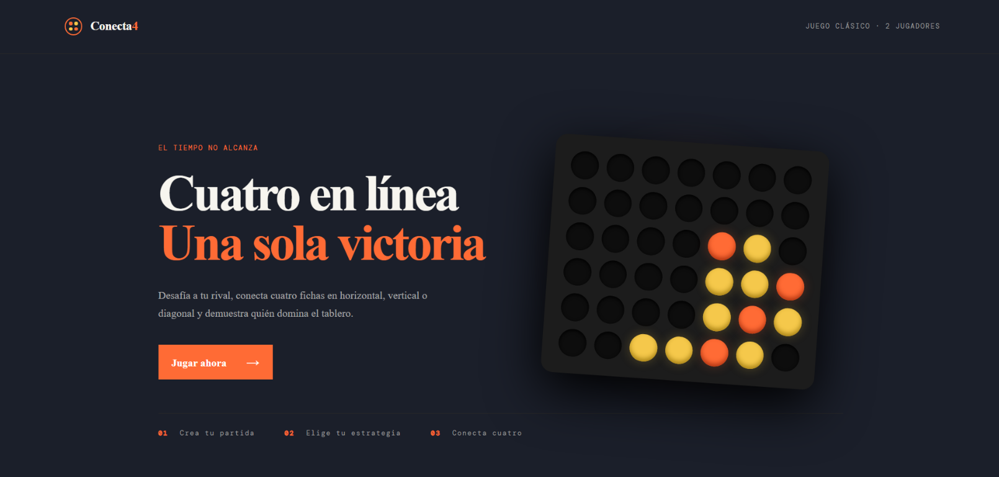
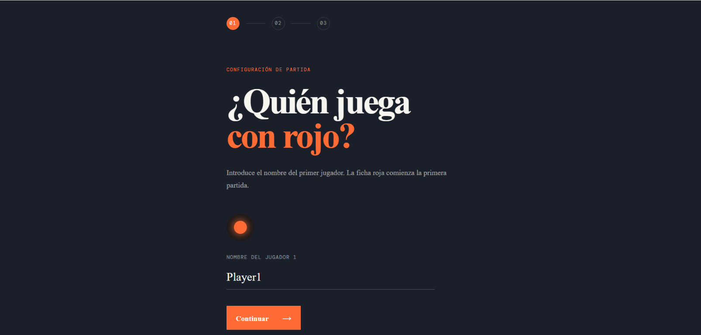
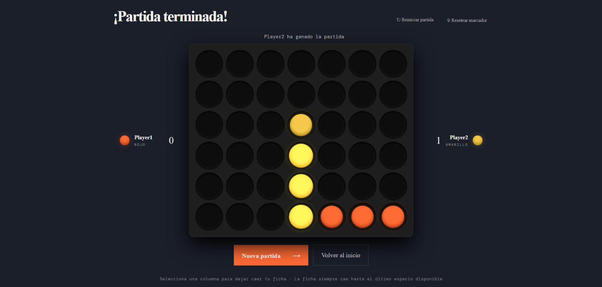
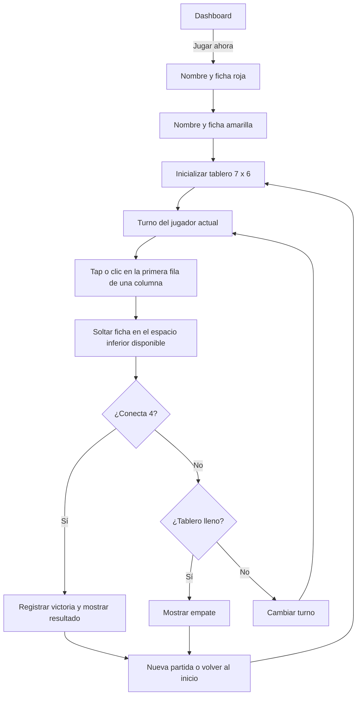

# React + Vite

This template provides a minimal setup to get React working in Vite with HMR and some ESLint rules.

Currently, two official plugins are available:

- [@vitejs/plugin-react](https://github.com/vitejs/vite-plugin-react/blob/main/packages/plugin-react) uses [Oxc](https://oxc.rs)
- [@vitejs/plugin-react-swc](https://github.com/vitejs/vite-plugin-react/blob/main/packages/plugin-react-swc) uses [SWC](https://swc.rs/)

## React Compiler

The React Compiler is not enabled on this template because of its impact on dev & build performances. To add it, see [this documentation](https://react.dev/learn/react-compiler/installation).

## Expanding the ESLint configuration

If you are developing a production application, we recommend using TypeScript with type-aware lint rules enabled. Check out the [TS template](https://github.com/vitejs/vite/tree/main/packages/create-vite/template-react-ts) for information on how to integrate TypeScript and [`typescript-eslint`](https://typescript-eslint.io) in your project.

# juega-4
classic-game

## Capturas

### Dashboard principal

### Configuración del jugador

### Partida en curso o finalizada

## Conecta-4

Juego local para dos personas, con tablero de 7 columnas por 6 filas. Los nombres
se guardan en `localStorage`; no requiere servidor ni base de datos.

### Flujo del juego

La primera partida comienza con rojo; la segunda con amarillo y así
sucesivamente. El botón **Reiniciar partida** conserva el marcador y alterna
el jugador inicial. **Resetear marcador** pone ambas victorias en cero.

Durante la partida, cada jugador puede seleccionar el icono de lápiz junto a
su nombre para editarlo. El nuevo nombre se guarda al pulsar Enter o al salir
del campo.
